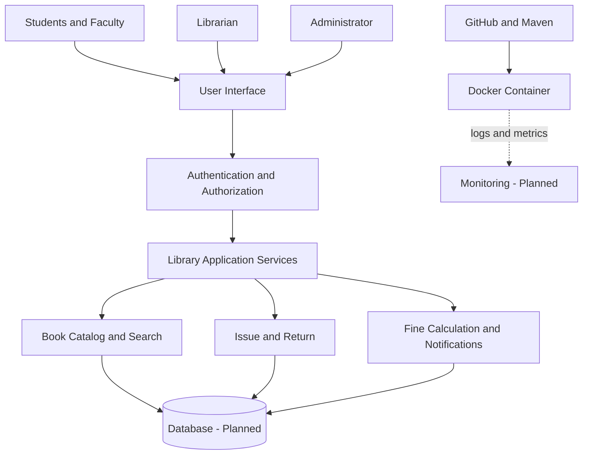

# Library Management Platform — System Architecture

## Notes

- The Java demo application runs successfully inside Docker.
- Database integration and the full user interface are planned work.
- Monitoring and additional infrastructure are planned for later phases.
